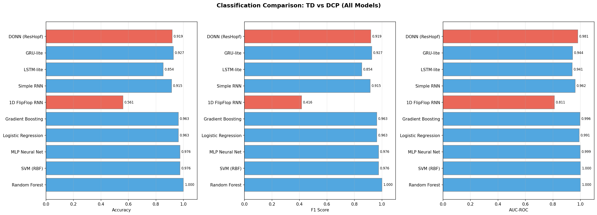
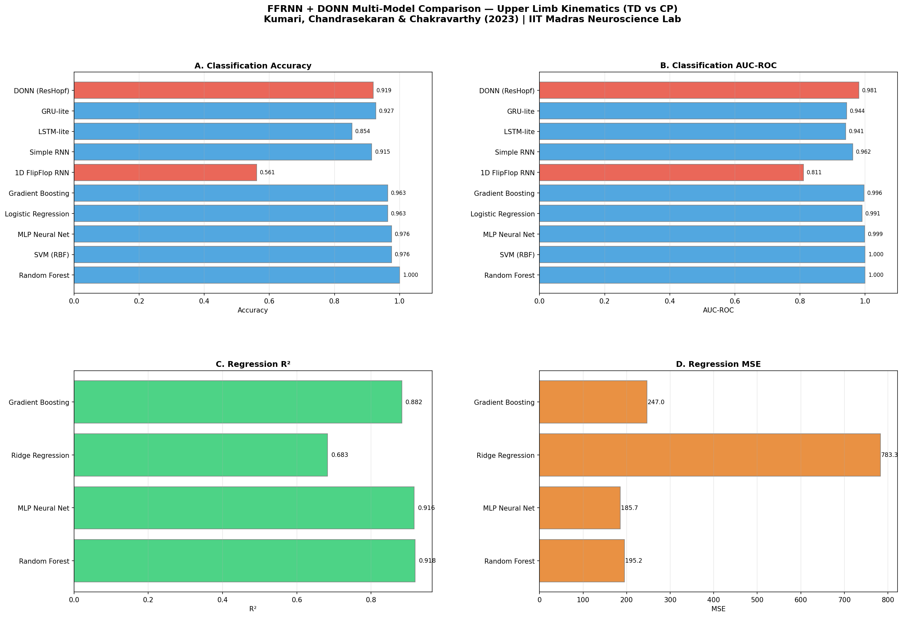
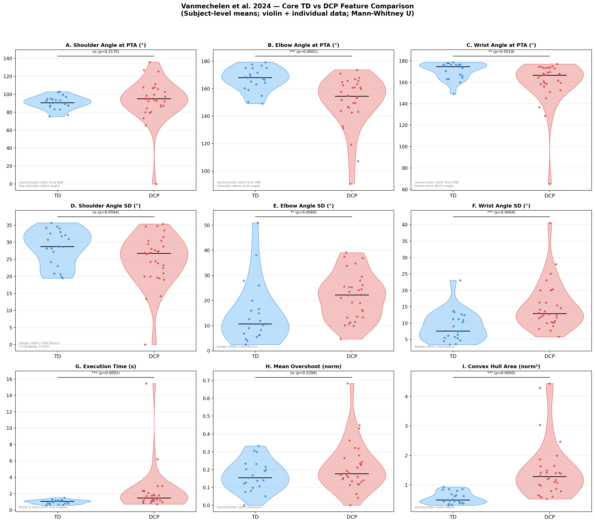
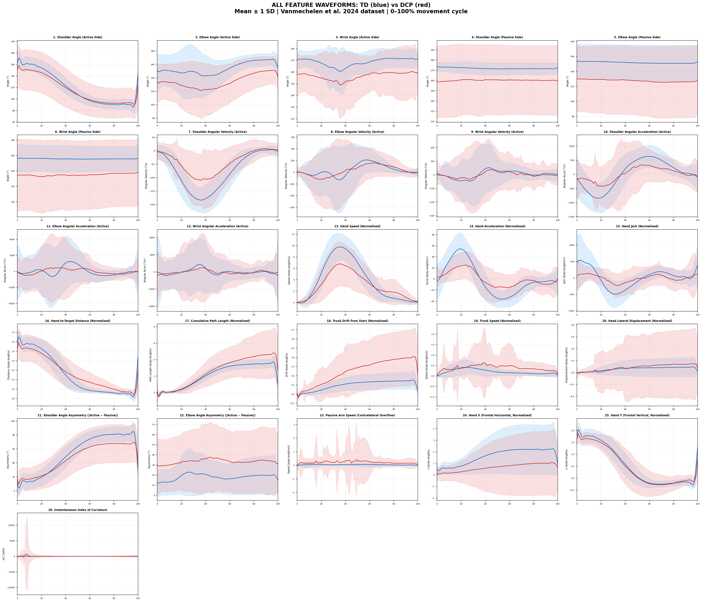
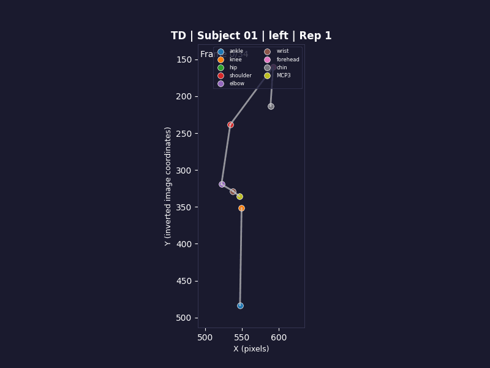

# Dyskinetic CP Reaching Benchmark

Classifying **dyskinetic cerebral palsy (DCP)** vs **typically developing (TD)** children from 2D markerless (DeepLabCut) upper-limb kinematics during a reaching-sideways task. The repo benchmarks classical ML models, from-scratch recurrent cells (Flip-Flop RNN, Simple RNN, LSTM-lite, GRU-lite) and a **DONN (Deep Oscillatory Neural Network, ResHopf)** model. It also produces interpretable kinematic feature plots, waveform plots and pose-skeleton animations.

- **Dataset:** 51 participants (30 DCP, 21 TD), aged 5–24 y, 8 repetitions each = **408 trials**
- **Input:** per-frame x/y keypoints (head, shoulder, elbow, wrist, MCP3, target) and joint angles (`data/*.xlsx`)
- **Stack:** Python, NumPy, pandas, SciPy, scikit-learn, PyTorch, matplotlib/seaborn

## Repository structure

```
├── data/                     408 trial files (NN_side_group_repK.xlsx)
├── src/
│   ├── 01_model_benchmark.py     Multi-model benchmark: RNN cells + sklearn + DONN, classification & regression → outputs/
│   ├── 02_feature_plots.py       TD vs DCP kinematic features + statistics → feature_plots/
│   ├── 03_waveform_plots.py      Mean ± SD time-normalised waveforms, per-point Mann-Whitney U → waveform_plots/
│   ├── 04_donn_reshopf.py        Stand-alone DONN (ResHopf) classifier, subject-grouped CV → outputs/
│   └── 05_pipeline_pose_videos.py End-to-end pipeline + skeleton GIFs → output/, pose_videos/
├── outputs/                  Benchmark results (CSV), confusion matrices, ROC curves, summaries
├── output/                   Trial features, subject-grouped CV results, feature importance
├── feature_plots/            13 feature figures + stats CSVs
├── waveform_plots/           27 waveform figures
├── pose_videos/              408 pose-skeleton GIFs (one per trial)
├── FFRNN_DONN_UpperLimb_CP.pptx  Presentation of the work
└── original_dataset/         Original dataset archives and README (unmodified)
```

## Quick start

```bash
pip install -r requirements.txt
python src/01_model_benchmark.py        # all models → outputs/
python src/02_feature_plots.py          # → feature_plots/
python src/03_waveform_plots.py         # → waveform_plots/
python src/04_donn_reshopf.py           # → outputs/
python src/05_pipeline_pose_videos.py   # → output/, pose_videos/
```

All paths are relative to the repo root, so the scripts work from any location once the repo is cloned.

## Results

### Subject-grouped cross-validation (no subject appears in both train and test)

| Model | Script | Accuracy | F1 | AUC |
|---|---|---|---|---|
| DONN (ResHopf) | `01` / `04` | **0.919** | **0.919** | **0.981** |
| Random Forest | `05` | 0.904 | 0.919 | 0.924 |
| SVM (RBF) | `05` | 0.829 | 0.856 | 0.901 |
| Gradient Boosting | `05` | 0.817 | 0.844 | 0.872 |

### Trial-level 80/20 split (`01_model_benchmark.py`)

| Model | Accuracy | F1 | AUC |
|---|---|---|---|
| Random Forest | 1.000 | 1.000 | 1.000 |
| SVM (RBF) | 0.976 | 0.976 | 1.000 |
| MLP Neural Net | 0.976 | 0.976 | 0.999 |
| Logistic Regression | 0.963 | 0.963 | 0.991 |
| Gradient Boosting | 0.963 | 0.963 | 0.996 |
| GRU-lite | 0.927 | 0.927 | 0.944 |
| Simple RNN | 0.915 | 0.915 | 0.962 |
| LSTM-lite | 0.854 | 0.854 | 0.941 |
| 1D FlipFlop RNN | 0.561 | 0.416 | 0.811 |

> **Note on evaluation:** in the trial-level split, repetitions from the same participant can appear in both the train and test sets, so these scores are optimistic. The subject-grouped results above are the fairer estimate of how the models generalise to new patients.

### Regression: joint-angle prediction (trial-level 80/20 split)

| Model | MSE | R² | MAE |
|---|---|---|---|
| Random Forest | 195.2 | 0.918 | 3.42 |
| MLP Neural Net | 185.7 | 0.916 | 5.43 |
| Gradient Boosting | 247.0 | 0.882 | 7.60 |
| Ridge Regression | 783.3 | 0.683 | 15.92 |

### Sample figures

| | |
|---|---|
|  |  |
|  |  |



## Data source and citation

The data come from the AVI-DYS project (KU Leuven), analysed retrospectively from IDCA:

> Vanmechelen I, Van Wonterghem E, Aerts J-M, Hallez H, Desloovere K, Van de Walle P, Buizer AI, Monbaliu E, Haberfehlner H. *Markerless motion analysis to assess reaching-sideways in individuals with dyskinetic cerebral palsy: a validity study.* Journal of Biomechanics 173 (2024) 112233. doi:10.1016/j.jbiomech.2024.112233
> Replication data: KU Leuven RDR, doi:10.48804/BZM9SJ

All rights to the data belong to the original authors. See `original_dataset/README.txt` for the full dataset description.
